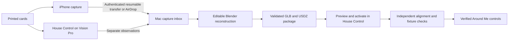

# Paired scanning and printable cards

The iPhone owns RoomPlan, posed photography, depth and original captures. House Control
owns the Mac capture host, Vision Pro observations, device identity and physical controls.
The exact interoperable fields and limits are in [spatial-contract.md](spatial-contract.md).



## Print and replace cards

Use Python with Pillow and ReportLab installed. Refresh from the private House Control
plan, never the public demonstration plan:

```sh
python3 -m pip install -r requirements-markers.txt
python3 tools/marker_kit.py \
  --plan "$HOME/Library/Application Support/HouseControl/plan.json"
```

Private outputs are under `output/marker-kit/` and `output/pdf/`. Keep `registry.json`
with the kit: it preserves identities, assignments and original image hashes across
reprints. The complete Letter and A4 PDFs have the same card dimensions. Both have a
cover, room/device page index, one checkpoint per page and four device cards per page.
Print at Actual Size / 100%, single-sided, on matte paper. Measure the 100 mm ruler.
Do not use Fit to Page. Keep the entire image and QR quiet border when cutting.

Cut along the outer card trim lines, not around the tracking square alone. Mount cards
flat, keep tape off the artwork, and choose a clear viewing position without reflections.
Named device cards go close beside their matching fixture in the same room; their exact
offset is confirmed during binding. Checkpoint cards go on fixed walls or door frames,
not swinging doors, furniture or movable devices. Record the chosen position and review
placement if either the card or fixture moves.

The four cards marked **Unassigned device** are spares. Keep them aside until a new device
is selected during setup; they are not extra room checkpoints. Begin with C001 in
Office / Entrance, two nearby lamps and another device category, then validate this pilot
before mounting the remaining kit.

For a pilot or replacement, use `--only C001,D001,D002 --pdf output/pdf/replacements`.
For additional spare cards use `--add-spares 4`; for more fixed checkpoints use
`--add-checkpoints 2`. These append IDs and do not renumber
existing devices. Retired device cards remain recognizable in the manifest; do not
reuse their physical position as a current fixture without setup. A missing image is
regenerated identically. Altered artwork under an existing ID causes generation to fail.

The six checkpoint cards use 140 mm square registered images. Device/spare cards use
70 mm images on 90 × 120 mm cards. Their QR links identify setup records only; they
contain no pairing key, hardware address or command. Labels and QR codes are outside
the registered crop. Vision Pro recognizes the artwork without camera-feed access.

## Capture workflow

1. In House Control on the Mac, open Scan & Calibrate, import the kit, and enable
   the dedicated capture host. Keep the Mac awake during the session.
2. In the scanner, open Paired capture and use the Mac's capture pairing link.
   Download the matching kit. This credential cannot use House Control command RPCs.
3. Mount checkpoint cards flat on fixed building features; record the mounting
   location. Device cards belong beside fixtures. Confirm their card-to-fixture offsets
   in House Control, and move neither card nor fixture after verification.
4. Scan one room and its connecting doorway/hallway. Structure, photographs, tracking
   and house alignment are shown separately. Image observations are provisional.
5. Use Details & cards to label an object and select each reference view. Use the
   shutter after closing the panel. Capture clean photographs with temporary cards
   outside the frame. Hidden/missing views remain missing evidence.
6. Finish the session and use Send saved captures. Interrupted uploads resume from
   durable acknowledged offsets; the Mac verifies every SHA-256 before completing.
   Originals remain on the phone. AirDrop continues to work independently.
7. Use House Control on Vision Pro to inspect coverage and record separate headset
   scene observations. These do not automatically alter accepted geometry or alignment.

The scanner shares its existing AR session with image detection. A duplicate/moved
card or estimated print-scale discrepancy requires review; it never silently replaces
the house origin. Seeing a single image is insufficient to establish house accuracy.

## Reconstruction and exports

Retain original ZIPs, photos, world maps and source meshes in ignored storage. Use the
existing scan-to-threejs conversion to preserve session-to-zone-to-house transforms.
The Blender source stays editable and includes source-photo/provenance annotations.

```sh
/Applications/Blender.app/Contents/MacOS/Blender --background \
  --python tools/export_spatial_blender.py -- \
  --blend PRIVATE/Room.blend --room PRIVATE/room.json \
  --out output/spatial-assets/room-v1 --room-id STABLE_ROOM_ID

python3 tools/spatial_package.py \
  --room PRIVATE/room.json --assets output/spatial-assets/room-v1 \
  --kit output/marker-kit --room-id STABLE_ROOM_ID \
  --house-id STABLE_HOUSE_ID --name "Room name" \
  --output output/spatial-home/room-v1
```

The exporter writes a derived `.blend`, GLB, USDZ, architectural collision USDZ and
object evidence index. Original `.blend` files are not overwritten. Stable object IDs,
parent relationships, metre dimensions and existing custom provenance survive export.
Exports require a new revision folder and reject paths that would overwrite the editable input.
The exported GLB/USDZ are reimported to verify axis/scale agreement within 5 mm.
Use `--metadata-glb PRIVATE/reviewed.glb` to preserve reviewed Safari cutaway tags
from an earlier viewer copy. It transfers only the three documented capture tags.

Supply measured floor information with `--level-id`, `--level-name`,
`--level-elevation`, `--floor-y` and optionally `--ceiling-y`. To assemble rooms, create
a private JSON file containing `houseID`, `name`, `levels`, and `rooms`. Each room entry
must include `package`, `roomID`, `levelID` and an explicit rigid `roomToHouse` matrix.
Package paths resolve relative to that JSON file. Run:

```sh
python3 tools/spatial_package.py --assemble PRIVATE/placements.json \
  --output output/spatial-home/whole-house-v1
python3 tools/spatial_package.py --validate output/spatial-home/whole-house-v1
```

Names never determine alignment. New packages stage privately and appear only after
validation succeeds. Existing outputs are not overwritten. Multi-room assembly keeps
room/source transforms and asset hashes, while leaving physical calibration unverified.
House Control stages its own copy, previews it, activates atomically and retains rollback.
Room mappings and fixture placement are separate from imported geometry.

## Verification commands

```sh
swift test --package-path packages/capture-link
python3 -m unittest discover -s tools -p 'test_*.py'
python3 -m unittest discover -s .agents/skills/scan-to-threejs/scripts -p 'test_*.py'
swift run --package-path tools/capture-integration CaptureIntegration \
  output/marker-kit output/spatial-home/ROOM_REVISION
```

The integration harness uses the sibling `house-control/core` checkout, a temporary
Bonjour service with an ephemeral in-memory pairing, and a disposable inbox. It tests both independently implemented
clients/host contracts, discovers the matching TXT identity, authenticates TLS, transfers the full card kit, resumes after
disconnect/restart, rejects bad checksums/paths/commands and tests different-key denial.
It never calls hardware control APIs. Launch the iOS simulator app with `-selftest` for
legacy scan/history/alignment/export checks; camera behavior requires a physical device.

Render each PDF with `pdftoppm -png -r 120`, decode all rendered PNG pages with the
compiled `tools/validate_marker_qr.swift`, then run `tools/validate_marker_pdf.py PDF KIT
QR_RESULTS_JSON`. This compares every embedded reference pixel to the manifest, checks
printed dimensions/cut rectangles/margins/the ruler, and matches all decoded QR links.
Visually inspect every rendered page too; automated checks do not replace printed tests.

## Acceptance gates

Software checks do not establish physical alignment or home-control readiness.

| Gate | Software deliverable | Physical acceptance |
| --- | --- | --- |
| Pilot cards/model | Matching PDFs/images/QR manifest; Office / Entrance GLB/USDZ | Actual-size print recognition on both devices; independent dimensions |
| Paired capture | Resumable authenticated channel; separate headset observations | Office / Entrance plus hallway; phone-only versus paired comparison |
| Physical controls | Placement/calibration/proximity recovery in House Control | Two adjacent lamps and another category; deliberate action and measured readback |
| Whole loft | Appendable indexed kit; explicit multi-room/floor export | Both floors scanned, objects reconstructed, repeated route and sustained profiling |

At least three independent building points, spaced at least 50 cm apart and separate
from the alignment card, must each be within 10 cm. Adjacent fixtures need tighter
placement or explicit selection. Test wrong print scale, duplicate/covered/moved cards,
stale kits, replacements, restart/recentering, permissions and network loss. Controls
must suspend on uncertain placement; ordinary dashboard controls remain available.
No full-house readiness or combined-sensor accuracy improvement is claimed until these
measurements are recorded. Keep all personal captures, PDFs and development resources
ignored by Git; omit them from distribution builds.
